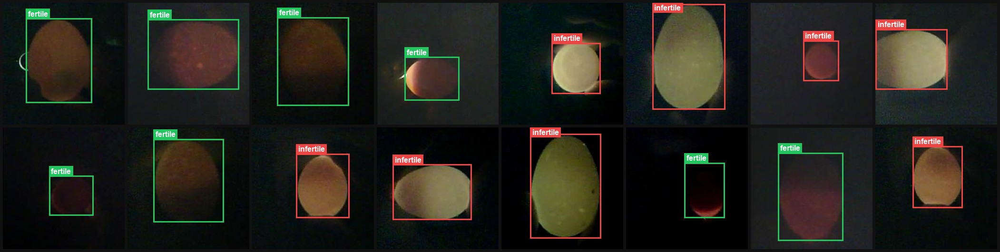
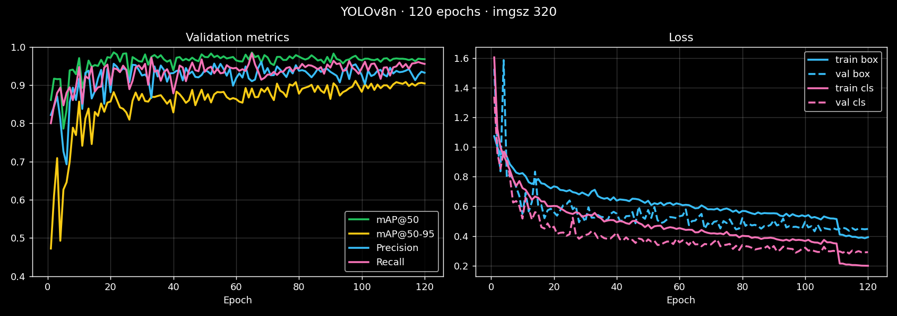
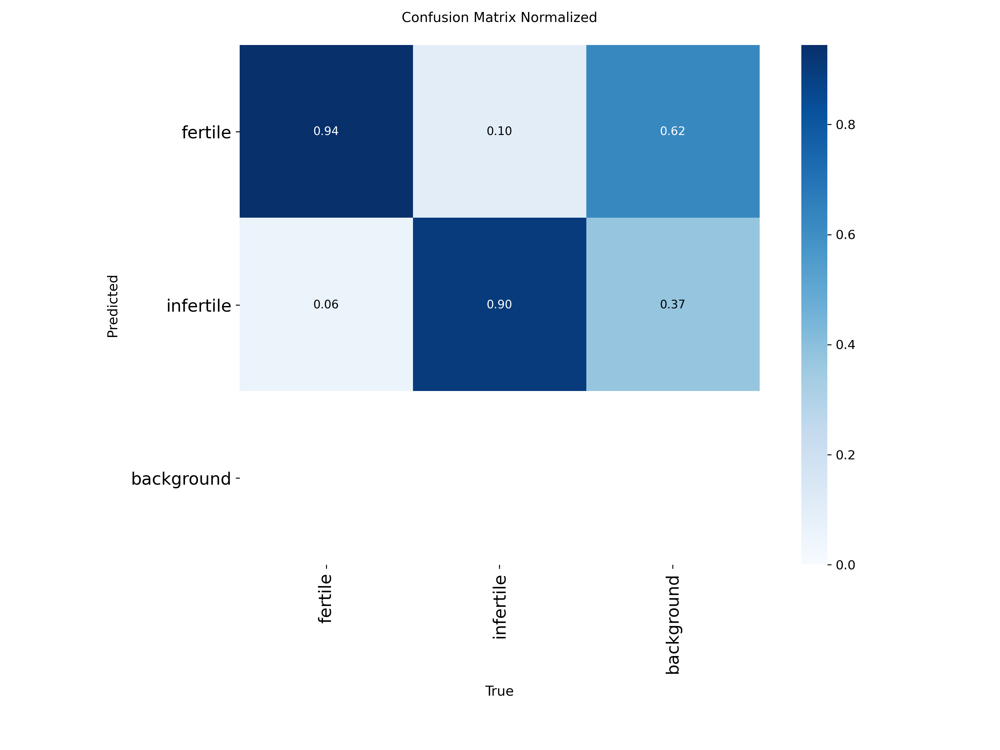
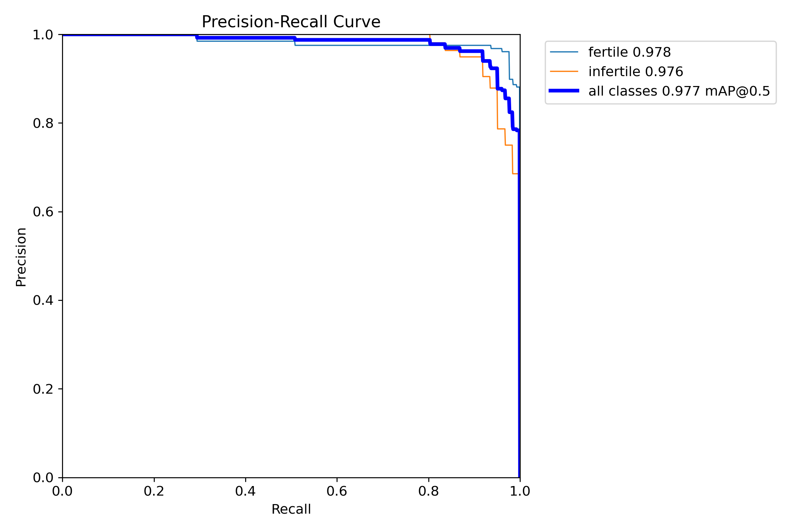
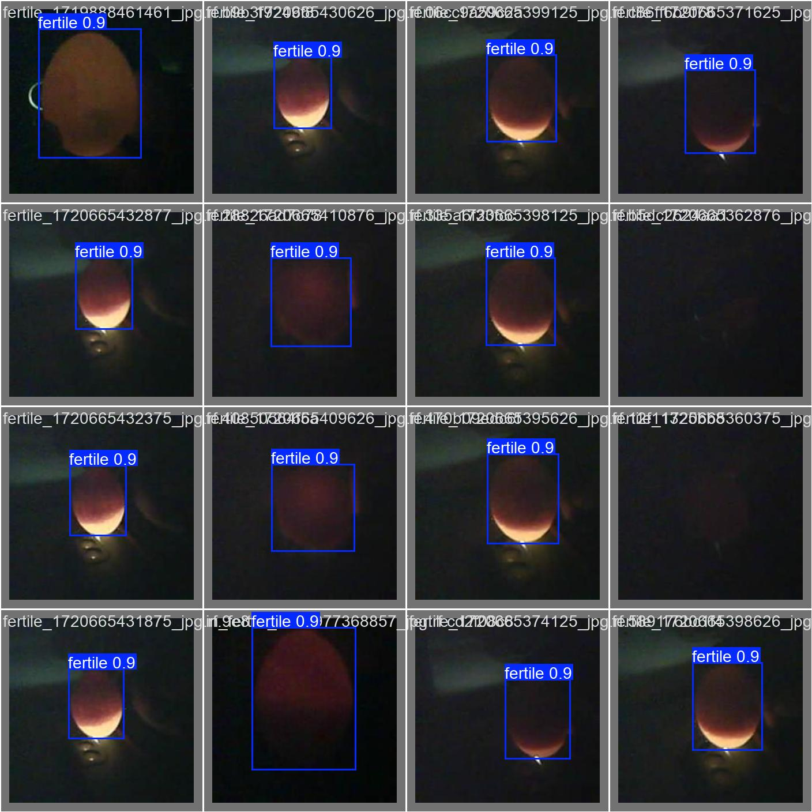
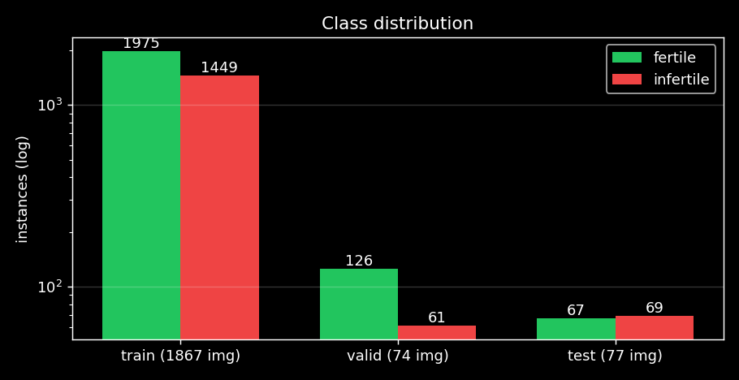
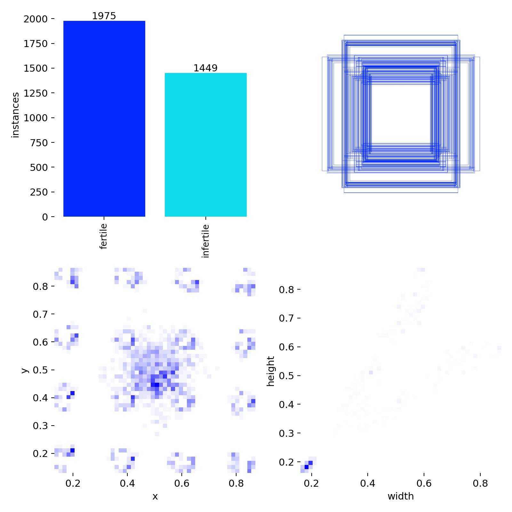

<div align="center">

# 🥚 YOLOv8-Based Egg Fertility Detection for Automated Candling

### Deteksi fertilitas telur berbasis YOLOv8 pada perangkat edge (Raspberry Pi)

*Egg fertility detection: is this egg fertile or infertile? Answered in ~35 ms on CPU.*


</div>

---

Repositori ini berisi prototipe alat *candling* (peneropongan telur) otomatis. Telur disinari dari bawah, lalu kamera dan model **YOLOv8n** mengklasifikasikan setiap telur di frame sebagai **fertile** (berembrio) atau **infertile**. Proyek ini dikerjakan dalam penelitian bersama **Bapak M. Latif** (Kolabnas) dan mencakup tiga bagian: model AI, desain mekanik (Autodesk Inventor), dan skema elektronik (Fritzing).

<p align="center"></p>
<p align="center"><sub>Sampel dataset training dengan ground-truth bounding box. Hijau = fertile, merah = infertile.</sub></p>

## 📊 Performa Model

Model **YOLOv8n** (3,0 M parameter, 8,1 GFLOPs), dilatih 120 epoch pada `imgsz=320` di CPU (Intel i5-12450H, ±10 jam).

| Split | Gambar | Instance | Precision | Recall | mAP@50 | mAP@50-95 |
|:--|--:|--:|--:|--:|--:|--:|
| **Validation** (best.pt) | 74 | 187 | 0.954 | 0.939 | **0.977** | **0.911** |
| **Test** (held-out) | 77 | 136 | 0.892 | 0.973 | **0.980** | **0.899** |

| Kelas (val) | Precision | Recall | mAP@50 | mAP@50-95 |
|:--|--:|--:|--:|--:|
| 🟢 fertile | 0.964 | 0.960 | 0.978 | 0.883 |
| 🔴 infertile | 0.945 | 0.918 | 0.976 | 0.939 |

⚡ **Inferensi:** ±35 ms/gambar di CPU laptop. Model sudah diekspor ke **ONNX** untuk deployment edge.

### Kurva training

<p align="center"></p>

<table>
<tr>
<td width="50%"></td>
<td width="50%"></td>
</tr>
<tr>
<td align="center"><sub>Confusion matrix (dinormalisasi)</sub></td>
<td align="center"><sub>Kurva Precision–Recall</sub></td>
</tr>
</table>

### Contoh prediksi (validation batch)

<p align="center"></p>

## 🗂️ Dataset

Sumber: [egg_fertile_infertile_detection v7](https://universe.roboflow.com/project-kece/egg_fertile_infertile_detection/dataset/7) (Roboflow Universe, lisensi **CC BY 4.0**), format YOLOv8.

- **2.018 gambar**, 2 kelas: `fertile`, `infertile`
- Preprocessing: auto-orient, resize 224×224
- Augmentasi Roboflow (3×): rotasi 90° acak, brightness ±15%
- Augmentasi saat training: rotasi ±15°, translate 0.1, scale 0.2, flip LR, HSV jitter, mosaic 0.7, mixup 0.1

<table>
<tr>
<td width="55%"></td>
<td width="45%"></td>
</tr>
</table>

## 🚀 Quick Start

```bash
pip install ultralytics
```

```python
from ultralytics import YOLO

model = YOLO("Citra digital/egg_fertile_infertile_detection.v7-2015-img-br15-rotated-single-multi-egg.yolov8/code/runs/detect/train/weights/best.pt")
results = model.predict("telur.jpg", imgsz=320, conf=0.5, save=True)
```

Training ulang: jalankan [`training.ipynb`](Citra%20digital/egg_fertile_infertile_detection.v7-2015-img-br15-rotated-single-multi-egg.yolov8/code/training.ipynb) atau [`train_all.py`](Citra%20digital/egg_fertile_infertile_detection.v7-2015-img-br15-rotated-single-multi-egg.yolov8/code/train_all.py) (membandingkan YOLOv8n vs YOLOv8s lalu ekspor TFLite).

> ⚠️ `data.yaml` masih memakai path absolut Windows. Ubah `train`/`val`/`test` sesuai lokasi clone kamu.

## 📁 Struktur Repo

```
.
├── assets/                     # Gambar untuk README
├── Citra digital/
│   └── egg_fertile_infertile_detection...yolov8/
│       ├── train/ valid/ test/ # Dataset (images + YOLO labels)
│       ├── data.yaml
│       ├── code/
│       │   ├── training.ipynb  # Pipeline utama: train → eval → export
│       │   ├── train_all.py    # Perbandingan YOLOv8n vs YOLOv8s
│       │   ├── cek_var.py      # Inferensi satu gambar
│       │   ├── cek_ujuran.py   # Cek variasi dimensi gambar
│       │   ├── hitung_gambar.py# Statistik label per kelas
│       │   └── runs/detect/    # Hasil training + weights (best.pt, best.onnx)
│       ├── runs/detect/        # Run eksperimen tambahan & prediksi
│       └── gambar random cek/  # Gambar uji acak
├── body.ipt, pembatas.ipt, spring.ipt, rangka kasar.ipt/.idw/.pdf   # Desain mekanik (Autodesk Inventor)
├── OldVersions/                # Revisi CAD sebelumnya
└── skema.fzz                   # Skema elektronik (Fritzing)
```

## 🛠️ Hardware

- **Rangka & body:** Autodesk Inventor (`*.ipt`, gambar kerja `rangka kasar.idw` / [PDF](rangka%20kasar.pdf))
- **Elektronik:** Fritzing (`skema.fzz`)
- **Komputasi target:** Raspberry Pi + kamera, sumber cahaya candling di bawah telur

## 🙏 Acknowledgements

- Pembimbing penelitian: **Bapak M. Latif**
- Dataset: Roboflow Universe, *project-kece* (CC BY 4.0)
- Framework: [Ultralytics YOLOv8](https://github.com/ultralytics/ultralytics)
